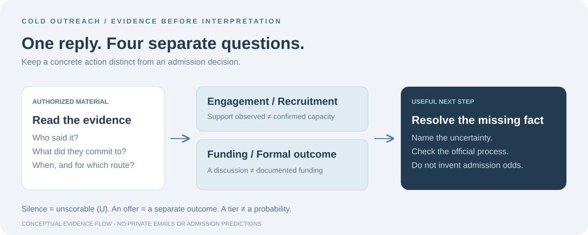

<div align="center">

# Cold Outreach Analyzer

### Read what the reply supports. Not what you hope it predicts.

An evidence-first skill for interpreting faculty engagement in PhD cold outreach.

**10 descriptive tiers · Silence stays unscorable · No admission-odds conversion**

[Try the example](#a-reply-to-an-action) · [Install](#install-and-use) · [Tier framework](skills/cold-outreach-analyzer/references/ten-tier-framework.md) · [Source notes](skills/cold-outreach-analyzer/references/sources.md)

</div>



A warm reply is not an offer. An interview is not a probability. Silence is not rejection. This skill turns user-supplied or explicitly authorized correspondence into a structured readout of **observed faculty engagement and support**, while keeping institutional decisions and funding separate.

> [!NOTE]
> The tiers are a practical interpretation heuristic, not a validated admissions instrument or probability scale. “High confidence” describes confidence in the interpretation, never a high chance of admission. The skill does not automatically scan private inboxes or send messages.

## A reply to an action

**Fictional example from [consistency case S08](skills/cold-outreach-analyzer/references/synthetic-evaluation.md)**. No private correspondence is shown.

> “Send your application ID; I will personally review it before our shortlist.”

| Readout | Interpretation |
| --- | --- |
| Observed evidence | A professor explicitly promises applicant-specific personal review |
| Current route tier | **T6**, personal review; no advocacy or supervision commitment is stated |
| Tier confidence | High for this wording, assuming the speaker and context are verified |
| Admission mechanism | Unknown from this excerpt; identify who makes the final decision |
| Recruitment / funding | Unknown / unknown |
| Formal outcome | None stated |
| Acceptance likelihood | **Not estimable from this correspondence** |
| Next action | Clarify the program's review process and what the requested ID is used for |

This is a worked reading of a synthetic case, not a model benchmark. A later message may change the current route status; keep earlier evidence in dated history rather than silently overwriting it.

## Install and use

Clone the repository, then copy the **complete skill directory** into the location supported by your host:

```bash
git clone https://github.com/yuzhang-zhong/cold-outreach-analyzer.git
cd cold-outreach-analyzer

# Project-local installation into the current project
mkdir -p .agents/skills
cp -r skills/cold-outreach-analyzer .agents/skills/
```

For a different target project, use that project's `.agents/skills/` path. For user-wide Codex installation, copy the same directory to `$CODEX_HOME/skills/cold-outreach-analyzer/`, using your actual configured Codex home. Keep `SKILL.md` and `references/` together. Reload the session if needed.

**Example prompt:**

> Interpret this faculty reply using Cold Outreach Analyzer. The program is [program], the degree is [degree], the application cycle is [cycle], and the message date is [date]. Separate observed engagement, admissions authority, recruitment, funding, and any formal outcome. Preserve missing facts and suggest one next action without assigning admission odds.

Provide only the material needed for the analysis. Remove personal identifiers where possible. The skill can use specific relevant correspondence only when you authorize access and the host's tools and policies permit it.

## What the readout includes

- Minimal evidence excerpts, the speaker, dates, and whether the action was individualized.
- A current route tier, dated signal history, and interpretation confidence.
- The admission mechanism and the authority of each source.
- Separate, time-bounded recruitment and funding statuses, including conditions.
- Formal institutional outcomes, unresolved conflicts, missing facts, limitations, and one practical next step.

The full [output format](skills/cold-outreach-analyzer/SKILL.md#output-format) keeps these fields explicit. The skill is for interpreting correspondence, not general statement-of-purpose editing or ranking applicants.

## The ten tiers

| Tier | Observed evidence |
| --- | --- |
| T1 | Individualized, concrete commitment to supervise and/or support a specific funding path, conditional on named institutional approval where applicable |
| T2 | Explicit individualized advocacy to admissions decision-makers, without a supervision commitment |
| T3 | Individualized substantive selection interview or conversation; invitation, scheduled, and completed states are distinguished |
| T4 | Substantive research evaluation, such as probing research or assessed proposal feedback |
| T5 | Individualized research-fit discussion with a concrete research-related next step, without clear evaluation or advocacy |
| T6 | Applicant-specific routing or personal review explicitly promised |
| T7 | Current-cycle recruiting intent paired with generic encouragement; capacity may still be conditional |
| T8 | Noncommittal positive wording or generic encouragement without confirmed current-cycle capacity |
| T9 | Procedural-only response or general policy statement, without an applicant-specific final refusal |
| T10 | Applicant-specific rejection or unavailability that closes the named supervisor route and cycle |

This order describes the kind of support observed. Some signals overlap; mixed evidence can remain unresolved or span adjacent bands. General committee policy is T9; a clearly route-closing applicant-specific refusal is T10. A formal institutional offer or rejection is recorded separately as an outcome, not as a tier. Silence is U. See the full [tier rules](skills/cold-outreach-analyzer/references/ten-tier-framework.md).

## Research basis and limits

Official guidance documents materially different processes. [UBC Computer Science](https://www.cs.ubc.ca/students/grad/admissions/application-components-required-documents/online-application) says advance faculty contact is not required and describes matching PhD students by research area. [Oxford](https://www.ox.ac.uk/admissions/graduate/application-guide/starting-your-application/research-project-and-supervisor) says course rules vary and that even an enthusiastic supervisor does not guarantee admission. [ETH Zurich](https://ethz.ch/en/doctorate/finding-a-place.html) describes individual doctorates where a willing supervisor is required and positions are commonly tied to employment. These examples inform context checks; they are not a universal map of countries or fields. [CMU faculty guidance](https://www.cs.cmu.edu/~sherryw/faqs.html) discusses committee review and the limits of advance discussion; it is one faculty member's description, not a universal policy.

Public first-person accounts also show different outcomes. [Mushtari Sadia's Fall 2024 CS application log](https://mushtari-sadia.github.io/phdapp.html) reports interviews followed by both offers and rejections. [Jenna Russell's 2024 account](https://jenna-russell.github.io/blog/2024/applying/) reports admission without prior faculty contact at some accepting programs. [Jake Chanenson](https://jakec007.github.io/2021-04-01-cold-email-advice/) explicitly cautions that his self-reported reply experience may be luck. These are self-reports, not representative samples. They support caution, not numerical estimates. See the [source notes](skills/cold-outreach-analyzer/references/sources.md) and [public cases](skills/cold-outreach-analyzer/references/public-cases.md) for dates, evidence strength, missing information, and limits.

## Source dates and evidence strength

Official guidance pages that do not show a publication date are marked “undated; checked 2026-10-10.” Historical faculty essays retain their publication/update dates. First-person accounts are labeled self-reported; anonymous posts are lower-confidence anecdotes. The skill does not compute rates from any of these cases.

## What has been checked

The [synthetic evaluation notes](skills/cold-outreach-analyzer/references/synthetic-evaluation.md) document 18 hand-applied consistency cases and a separate five-case blind-review spot-check. They exercise ambiguous wording, routine versus individualized contact, conditional funding, chronology, silence, and formal outcomes.

These are fictional rubric checks, **not statistical validation, a benchmark, or a measured real-world classification accuracy**. No admission rates are computed from the source anecdotes.

## Important boundaries

- **U is missing evidence.** Silence, missing text, or unclear identity cannot be scored as rejection.
- **A route is not a whole application.** A supervisor's refusal is scoped to that person and cycle; a formal program decision is recorded separately.
- **Warmth is not authority.** Check who can actually decide admission, supervision, recruitment, and funding.
- **Keep conditions and dates.** Planned recruitment is not confirmed capacity; discussed funding is not documented funding.
- **Protect correspondence.** Do not put private emails, identities, personal contact details, or case-specific rankings in public artifacts. This repository uses public references and fictional examples.
- **Analysis does not authorize outreach.** A proposed next step is not a sent reply. Follow-up drafting is only done when asked, and sending is outside this skill's workflow.

## Repository guide

| File | Purpose |
| --- | --- |
| [SKILL.md](skills/cold-outreach-analyzer/SKILL.md) | Trigger, workflow, and structured readout |
| [Ten-tier framework](skills/cold-outreach-analyzer/references/ten-tier-framework.md) | Operational definitions and guardrails |
| [Sources](skills/cold-outreach-analyzer/references/sources.md) | Dated institutional and faculty guidance |
| [Public cases](skills/cold-outreach-analyzer/references/public-cases.md) | Paraphrased self-reports with evidence limits |
| [Synthetic checks](skills/cold-outreach-analyzer/references/synthetic-evaluation.md) | Fictional edge cases and consistency review |
